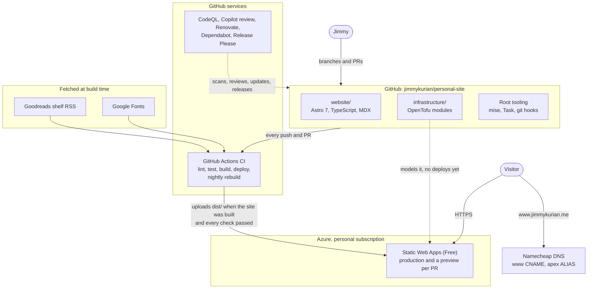

<!-- Copyright (c) 2026 Jimmy Kurian. All rights reserved. See LICENSE. Author: Jimmy Kurian. -->

# jimmykurian.me

The source of [jimmykurian.me](https://www.jimmykurian.me), Jimmy Kurian's personal site: a portfolio, a resume and a blog. It's a static [Astro](https://astro.build) site on Azure Static Web Apps, built and checked by GitHub Actions. The repository is public to read; see [License](#license).

## Status

Each badge is a check from the last CI run on `main` (`.github/workflows/ci.yml` writes them to the `badges` branch). On a pull request, the same checks report in a comment on the PR.

### Monorepo

| Branch | Headers | Lockfile | Dedupe | Workflows | Shell | EditorConfig | Markdown | Spelling | Inclusive language | YAML | Schemas | Commits |
| --- | --- | --- | --- | --- | --- | --- | --- | --- | --- | --- | --- | --- |
| main | [](https://github.com/jimmykurian/personal-site/actions/workflows/ci.yml?query=branch%3Amain) | [](https://github.com/jimmykurian/personal-site/actions/workflows/ci.yml?query=branch%3Amain) | [](https://github.com/jimmykurian/personal-site/actions/workflows/ci.yml?query=branch%3Amain) | [](https://github.com/jimmykurian/personal-site/actions/workflows/ci.yml?query=branch%3Amain) | [](https://github.com/jimmykurian/personal-site/actions/workflows/ci.yml?query=branch%3Amain) | [](https://github.com/jimmykurian/personal-site/actions/workflows/ci.yml?query=branch%3Amain) | [](https://github.com/jimmykurian/personal-site/actions/workflows/ci.yml?query=branch%3Amain) | [](https://github.com/jimmykurian/personal-site/actions/workflows/ci.yml?query=branch%3Amain) | [](https://github.com/jimmykurian/personal-site/actions/workflows/ci.yml?query=branch%3Amain) | [](https://github.com/jimmykurian/personal-site/actions/workflows/ci.yml?query=branch%3Amain) | [](https://github.com/jimmykurian/personal-site/actions/workflows/ci.yml?query=branch%3Amain) | [](https://github.com/jimmykurian/personal-site/actions/workflows/ci.yml?query=branch%3Amain) |

### Website

| Branch | Types | ESLint | Prettier | Stylelint | Dead code | API docs | Unit tests | Coverage | Build | Integration | End-to-end | Lighthouse |
| --- | --- | --- | --- | --- | --- | --- | --- | --- | --- | --- | --- | --- |
| main | [](https://github.com/jimmykurian/personal-site/actions/workflows/ci.yml?query=branch%3Amain) | [](https://github.com/jimmykurian/personal-site/actions/workflows/ci.yml?query=branch%3Amain) | [](https://github.com/jimmykurian/personal-site/actions/workflows/ci.yml?query=branch%3Amain) | [](https://github.com/jimmykurian/personal-site/actions/workflows/ci.yml?query=branch%3Amain) | [](https://github.com/jimmykurian/personal-site/actions/workflows/ci.yml?query=branch%3Amain) | [](https://github.com/jimmykurian/personal-site/actions/workflows/ci.yml?query=branch%3Amain) | [](https://github.com/jimmykurian/personal-site/actions/workflows/ci.yml?query=branch%3Amain) | [](https://github.com/jimmykurian/personal-site/actions/workflows/ci.yml?query=branch%3Amain) | [](https://github.com/jimmykurian/personal-site/actions/workflows/ci.yml?query=branch%3Amain) | [](https://github.com/jimmykurian/personal-site/actions/workflows/ci.yml?query=branch%3Amain) | [](https://github.com/jimmykurian/personal-site/actions/workflows/ci.yml?query=branch%3Amain) | [](https://github.com/jimmykurian/personal-site/actions/workflows/ci.yml?query=branch%3Amain) |

### Infrastructure

| Branch | Format | Validate | TFLint | Checkov | Provider pins | Module docs | Acceptance tests | Integration tests |
| --- | --- | --- | --- | --- | --- | --- | --- | --- |
| main | [](https://github.com/jimmykurian/personal-site/actions/workflows/ci.yml?query=branch%3Amain) | [](https://github.com/jimmykurian/personal-site/actions/workflows/ci.yml?query=branch%3Amain) | [](https://github.com/jimmykurian/personal-site/actions/workflows/ci.yml?query=branch%3Amain) | [](https://github.com/jimmykurian/personal-site/actions/workflows/ci.yml?query=branch%3Amain) | [](https://github.com/jimmykurian/personal-site/actions/workflows/ci.yml?query=branch%3Amain) | [](https://github.com/jimmykurian/personal-site/actions/workflows/ci.yml?query=branch%3Amain) | [](https://github.com/jimmykurian/personal-site/actions/workflows/ci.yml?query=branch%3Amain) | [](https://github.com/jimmykurian/personal-site/actions/workflows/ci.yml?query=branch%3Amain) |

### Security & Code Quality

| Branch | CodeQL | Code quality | Secret scanning | gitleaks | secretlint | npm audit | OSV | Licenses | Dependabot | Renovate | Dependency review |
| --- | --- | --- | --- | --- | --- | --- | --- | --- | --- | --- | --- |
| main | [](https://github.com/jimmykurian/personal-site/security/code-scanning) | [](https://github.com/jimmykurian/personal-site/security/code-scanning) | [](https://github.com/jimmykurian/personal-site/security/secret-scanning) | [](https://github.com/jimmykurian/personal-site/actions/workflows/ci.yml?query=branch%3Amain) | [](https://github.com/jimmykurian/personal-site/actions/workflows/ci.yml?query=branch%3Amain) | [](https://github.com/jimmykurian/personal-site/actions/workflows/ci.yml?query=branch%3Amain) | [](https://github.com/jimmykurian/personal-site/actions/workflows/ci.yml?query=branch%3Amain) | [](https://github.com/jimmykurian/personal-site/actions/workflows/ci.yml?query=branch%3Amain) | [](https://github.com/jimmykurian/personal-site/security/dependabot) | [](https://docs.renovatebot.com/) | [](https://docs.github.com/code-security/supply-chain-security/understanding-your-software-supply-chain/about-dependency-review) |

### Tech Stack

| Astro | TypeScript | MDX | Node.js | pnpm | Vitest | Playwright | OpenTofu | Task | mise |
| --- | --- | --- | --- | --- | --- | --- | --- | --- | --- |
| [](https://astro.build/) | [](https://www.typescriptlang.org/) | [](https://mdxjs.com/) | [](https://nodejs.org/) | [](https://pnpm.io/) | [](https://vitest.dev/) | [](https://playwright.dev/) | [](https://opentofu.org/) | [](https://taskfile.dev/) | [](https://mise.jdx.dev/) |

### Hosting Stack

| Azure | GitHub Actions | Namecheap | Cloudflare | Sentry | PostHog |
| --- | --- | --- | --- | --- | --- |
| [](https://azure.microsoft.com/products/app-service/static) | [](https://github.com/jimmykurian/personal-site/actions) | [](https://www.namecheap.com/) | [](https://www.cloudflare.com/web-analytics/) | [](https://sentry.io/) | [](https://posthog.com/) |

## Code metrics

The size and complexity of the code: lines of code without blanks or comments ([scc](https://github.com/boyter/scc)), and the cyclomatic complexity of every function (ESLint's `complexity` rule). After a merge that changes the code, `.github/workflows/code-metrics.yml` proposes an update in a pull request. Run `task metrics` to see them locally.

<!-- METRICS:START -->

| Metric | Website | Infrastructure | Total |
| --- | --- | --- | --- |
| Files | 24 | 8 | 32 |
| Lines of code | 3,089 | 138 | 3,227 |
| Functions | 176 | – | 176 |
| Average complexity | 1.9 | – | 1.9 |
| Max complexity | 9 | – | 9 |
| Modules | – | 2 | 2 |
| Resources | – | 3 | 3 |

<details>
<summary>The 10 most complex functions</summary>

| Function | Where | Complexity |
| --- | --- | --- |
| async arrow function | `website/src/pages/index.astro:908` | 9 |
| `installedPackages` | `website/scripts/check-licenses.mjs:96` | 8 |
| `main` | `website/scripts/check-licenses.mjs:135` | 8 |
| `load` | `website/src/lib/goodreads.ts:105` | 8 |
| `collectComplexity` | `website/scripts/code-metrics.mjs:38` | 7 |
| `retryDelay` | `website/src/lib/goodreads.ts:28` | 7 |
| `fetchFeed` | `website/src/lib/goodreads.ts:36` | 7 |
| `atom` | `website/scripts/check-licenses.mjs:42` | 6 |
| `licenseOf` | `website/scripts/check-licenses.mjs:86` | 6 |
| arrow function | `website/src/pages/index.astro:120` | 6 |

</details>

<!-- METRICS:END -->

## Repository

| Folder | What it is | Docs |
| --- | --- | --- |
| [`website/`](website/) | The Astro site: pages, components, content, the resume, and its unit, integration and end-to-end tests | [README](website/README.md), [AGENTS.md](website/AGENTS.md) |
| [`infrastructure/`](infrastructure/) | OpenTofu modules and tests for the Azure resources (not yet used to deploy) | [README](infrastructure/README.md), [AGENTS.md](infrastructure/AGENTS.md) |
| Root | Tooling shared by both: `.mise.toml`, `Taskfile.yml`, `.config/`, `.githooks/`, `.devcontainer/`, `.github/` | [CONTRIBUTING](CONTRIBUTING.md), [AGENTS.md](AGENTS.md) |

Coding agents start from the root [AGENTS.md](AGENTS.md), then read the subproject's own before working in it.

## Architecture

- **Content is data.** The pages render JSON collections and MDX posts, validated by the schemas in `website/src/content.config.ts`. A bad field fails the build instead of shipping.
- **Built once, served static.** There's no server, database, login or cookie. `public/staticwebapp.config.json` sets the security headers, the 404 page and caching.
- **External data comes in at build time.** `/reading/` is built from the Goodreads RSS feeds, covers and fonts are downloaded and optimized then, and the live site makes no third-party requests. A nightly rebuild picks up new books. Brief Goodreads errors are retried; if it's still down, the build fails and the last deploy stays live.
- **The resume is a page.** `/resume/` renders from the same data as the site, and CI prints it to `/resume.pdf`, so the two never disagree.
- **Infrastructure as code, in progress.** The Azure resources were created in the portal. `infrastructure/` models them as generic OpenTofu modules, tested against a mocked provider, ready to take over deploys later.

### System overview



[docs/architecture/](docs/architecture/README.md) has the rest: the C4 context and container views, a UML class diagram of the content model, and flow and sequence diagrams for the build, a change reaching production, the nightly rebuild and a visitor's request.

## Principles

- **Small and static.** No client framework: a few inline scripts, each respecting `prefers-reduced-motion`. Add an island only when a feature needs one.
- **Private by default.** Client names are anonymized, and the site and resume carry no home address, phone, personal email, clearance or patent application number. Tests check every published file for those patterns.
- **Measured without cookies.** Cloudflare Web Analytics, Sentry and PostHog run cookieless, with no replay or profiles, and only in production. A Content-Security-Policy allows no other outside host ([docs/observability.md](docs/observability.md)).
- **Accessible and fast.** The goal is WCAG 2.2 AA ([docs/accessibility.md](docs/accessibility.md)): axe checks the 2.0, 2.1 and 2.2 A and AA rules on every page at desktop and phone sizes. Lighthouse fails the build below 0.95 for accessibility.
- **Every check blocks.** Nothing only warns. A finding is fixed, or skipped inline with a reason.
- **One source of truth.** Tool versions live only in `.mise.toml`, and commands only in `Taskfile.yml`. CI and the git hooks run the same tasks you run locally.
- **Supply chain kept tight.** Actions are pinned to commit SHAs. Packages come only from registry.npmjs.org, with sha512 hashes. Renovate waits 7 days before taking a new version. gitleaks, CodeQL and secret scanning watch the code.
- **Reviewed changes only.** `main` takes squash-merged pull requests with signed commits, passing CI and CodeQL, and a Copilot review.
- **Own the writing.** Posts are published here first, then syndicated with canonical links back.
- **Editorial design.** Newsreader and Libre Franklin, a ruled ledger layout, and Sanzo Wada's color combination 207.

## Quality checks

Every check fails the build; none is warn-only. `task lint` runs them all, grouped into the repository, the website and the infrastructure, and `task test`, `task build`, `task test:integration`, `task test:e2e` and `task lighthouse` cover the rest. The git hooks run the fast ones on each commit and push.

On each pull request, CI runs every check for the parts that changed and posts one comment with a table of the results, the coverage and the test counts; merging needs them to pass. Renovate handles version updates weekly, Dependabot handles security updates, and Release Please versions `website/` and `infrastructure/`.

[CONTRIBUTING.md](CONTRIBUTING.md#quality-checks) lists every check, its config and the hooks.

## Getting started

```sh
mise install        # Node, OpenTofu and the linters, at the pinned versions
task install        # mise install, then the website's dependencies
task hooks:install  # the git hooks in .githooks/
task                # list every task
```

The devcontainer (`.devcontainer/`) does all of that on creation, for VS Code or Codespaces. [website/README.md](website/README.md) covers running the site and editing the content. [CONTRIBUTING.md](CONTRIBUTING.md) covers the workflow, commits and checks.

## Structure

```text
.github/workflows/       every check, the deploy and the PR check table (ci.yml); PR labels, assignee, title and template checks; releases; code metrics
.github/labeler.yml      which paths get which pull request label
.github/CODEOWNERS       Jimmy owns everything, so bot PRs request Jimmy's review
badges branch            the README status badges, written by CI (never merged; not a working branch)
.github/ISSUE_TEMPLATE/  bug, feature and subtask forms; PULL_REQUEST_TEMPLATE.md beside it
.github/renovate.json    version updates (weekly, grouped)
.github/dependabot.yml   security updates only
.github/*release-please* Release Please's settings and the current version of each package
.config/                 repo-wide check configs: commitlint and Lighthouse at the top, then
  formatters/              Prettier
  linters/                 gitleaks, secretlint, editorconfig, markdownlint, yamllint, v8r, lychee
  spelling/                cspell and the project word list
  licenses/                allowed licenses and excluded packages (with a README)
.githooks/               pre-commit, commit-msg and pre-push hooks (task hooks:install)
.devcontainer/           devcontainer with the pinned tools, dependencies and Chrome
.vscode/                 VS Code: recommended extensions, settings, debug configs, the dev-server task, snippets
.mise.toml               tool versions
.alexrc.yml              inclusive-language allow list (alex reads it only from the root)
Taskfile.yml             every check, test and build step, by name
docs/                    accessibility, architecture, deployment, design, observability, security and testing docs, and the docs style guide
infrastructure/          OpenTofu modules and tests for the Azure resources (see infrastructure/README.md)
website/                 the Astro site (see website/README.md)
AGENTS.md                what coding agents need on every task
LICENSE                  proprietary, all rights reserved
SECURITY.md              how to report a vulnerability, and how the site is secured
CONTRIBUTING.md          setup, workflow, commits, signing, checks before pushing, content and design rules
CODE_OF_CONDUCT.md       Contributor Covenant 2.1, adapted
```

## License

Proprietary. All rights reserved; see [LICENSE](LICENSE). The source is public to read, but I'm its only contributor and don't accept pull requests or issues ([CONTRIBUTING.md](CONTRIBUTING.md)). Third-party packages, fonts and icons keep their own licenses.
