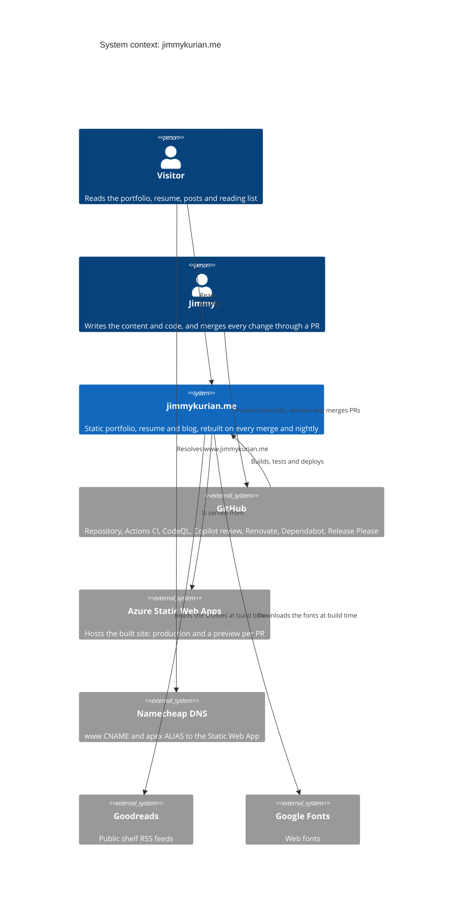
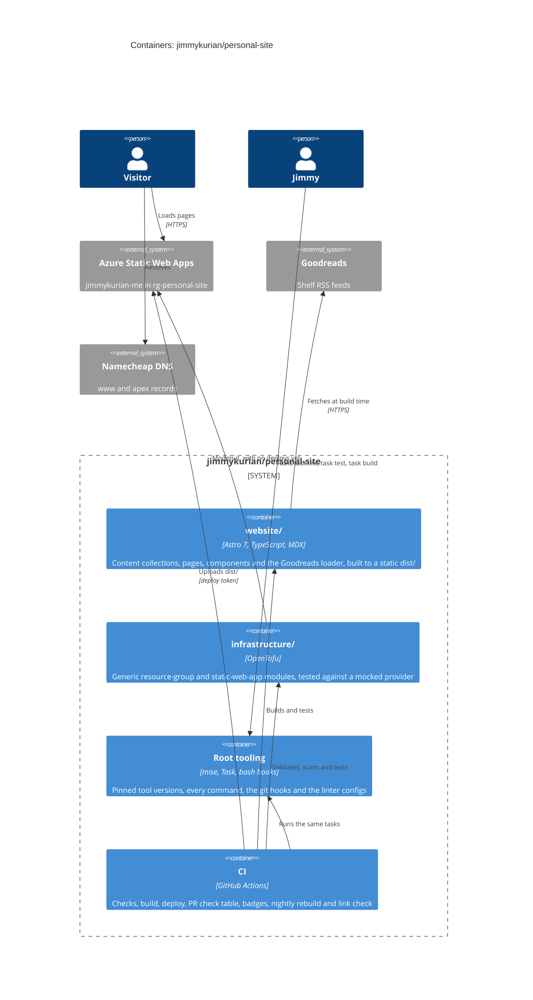

<!-- Copyright (c) 2026 Jimmy Kurian. All rights reserved. See LICENSE. Author: Jimmy Kurian. -->

# C4 diagrams

The site at two C4 levels: its context, then the containers inside the repository. Back to the [architecture overview](README.md).

## System context

Who uses the site, and the outside systems it depends on.

## Containers

What's inside the repository, and how each part reaches production.

## See also

- [Architecture index](README.md)
- [Flows](flows.md)
- [Deployment overview](../deployment/overview.md)

Last reviewed: 2026-10-20
