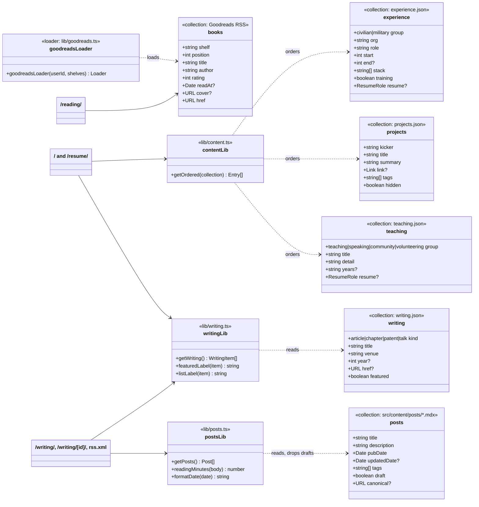

<!-- Copyright (c) 2026 Jimmy Kurian. All rights reserved. See LICENSE. Author: Jimmy Kurian. -->

# Content model

A UML class diagram of the content. Back to the [architecture overview](README.md).

## Collections, helpers and pages

The content collections in `website/src/content.config.ts`, the helpers in `website/src/lib/` and the pages that read them.

## See also

- [Architecture index](README.md)
- [Design guidelines](../design/design-guidelines.md)
- [TypeDoc API docs](../../website/docs/README.md)

Last reviewed: 2026-10-20
