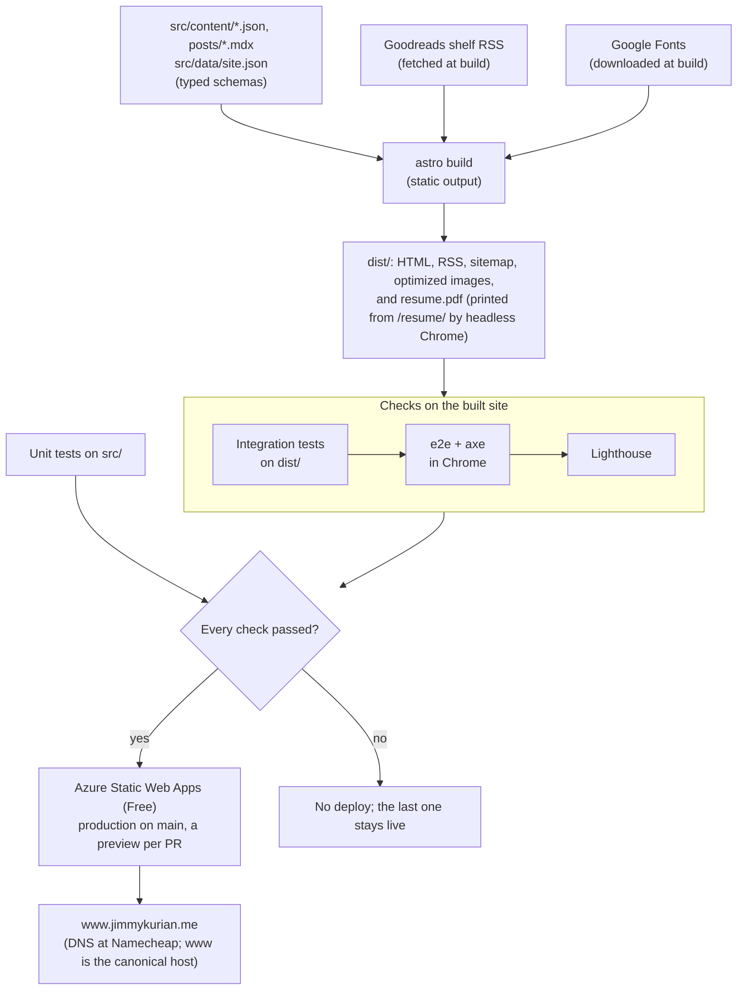
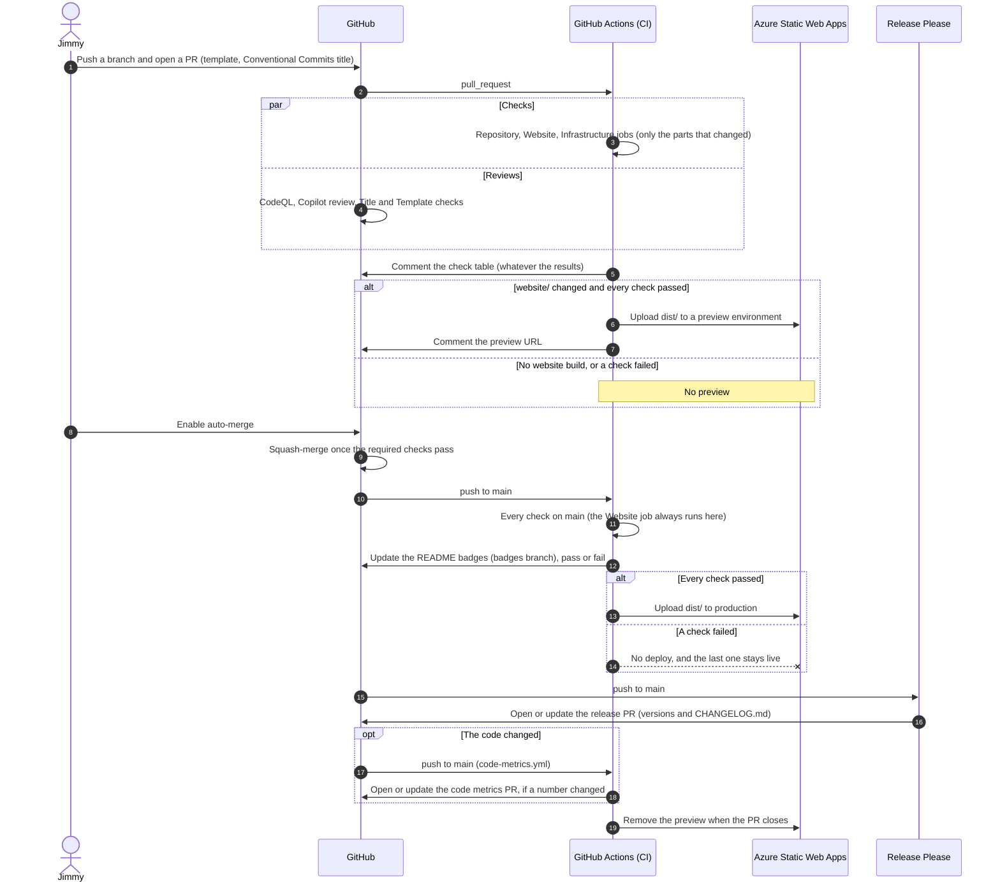
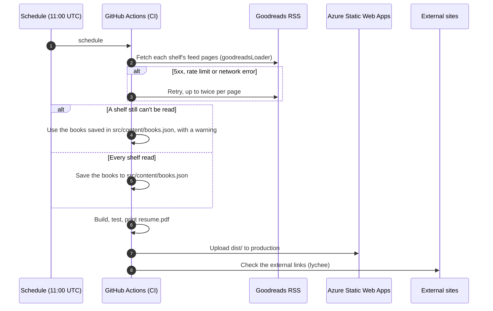
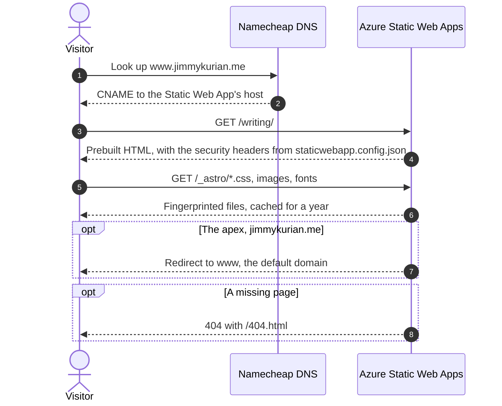

<!-- Copyright (c) 2026 Jimmy Kurian. All rights reserved. See LICENSE. Author: Jimmy Kurian. -->

# Flows

How the site is built and deployed, how a change reaches production, the nightly rebuild, and what happens when someone visits. Back to the [architecture overview](README.md).

## Build and deploy

## A change, from branch to production

## Nightly rebuild

## A visitor's request

## See also

- [Architecture index](README.md)
- [Deployment overview](../deployment/overview.md)
- [Testing strategy](../testing/testing-strategy.md)

Last reviewed: 2026-10-23
