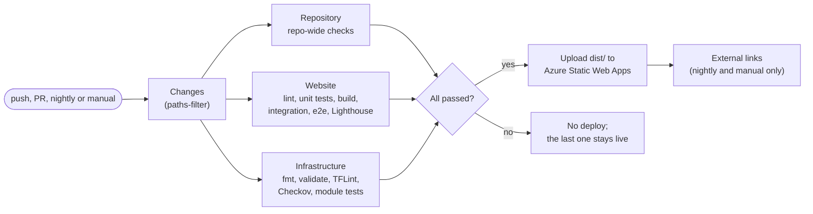

<!-- Copyright (c) 2026 Jimmy Kurian. All rights reserved. See LICENSE. Author: Jimmy Kurian. -->

# Deployment overview

How a change becomes the live site: one CI workflow builds, checks and uploads the static site to Azure Static Web Apps.

## Pipeline

`.github/workflows/ci.yml` runs every check and the deploy. A deploy happens only when every check job passes.

| Job | Runs | What it does |
| --- | --- | --- |
| Changes | Always | Decides which of `website/` and `infrastructure/` changed (`dorny/paths-filter`) |
| Repository | Always | Secrets, lockfile, audit, OSV, licenses, workflows, shell, Markdown, spelling, YAML, schemas, headers and commit messages |
| Website | When `website/` changed | Type-check, ESLint, Prettier, Stylelint, knip, the TypeDoc check, unit tests with coverage, the build and resume PDF, then integration, end-to-end and Lighthouse on the build |
| Infrastructure | When `infrastructure/` changed | `task infra:check`, the terraform-docs check and the module tests |
| Deploy | When the check jobs pass | Downloads the built `dist/` artifact and uploads it |
| Check table | Pull requests | Posts one comment with every check's result, the coverage and test counts |
| Badges | `main` | Writes the README status badges to the `badges` branch |
| External links | Nightly and manual | Checks the external links in the build with lychee |
| Close PR preview | A PR closes | Removes that PR's preview environment |

The build is never repeated for the deploy: the Website job uploads `website/dist/` as an artifact, and the deploy uploads that same artifact with `skip_app_build`.

## Triggers

| Trigger | Result |
| --- | --- |
| Pull request to `main` | A preview environment with its own URL, commented on the PR and removed when the PR closes |
| Push to `main` (a merged PR) | Production at <https://www.jimmykurian.me> |
| Nightly, 11:00 UTC | A rebuild, so `/reading/` picks up Goodreads changes, then the external link check |
| Manual (`workflow_dispatch`) | A rebuild on demand, plus the link check |

`main` takes changes only through squash-merged pull requests, and the ruleset requires the Title, Template, Repository, Website, Infrastructure and CodeQL checks. A job skipped because its files didn't change counts as passed. See [CONTRIBUTING.md, Workflow](../../CONTRIBUTING.md#workflow).

## Hosting

- **Azure Static Web Apps, Free plan,** in a personal Azure subscription. The app serves only static files: no functions, no server code.
- **`website/public/staticwebapp.config.json`** ships with the build and sets the security headers, the 404 page and year-long caching for the fingerprinted files in `/_astro/`.
- **DNS stays at Namecheap:** `www` is a CNAME to the app, and the apex is an ALIAS. `www` is the default domain, so the apex redirects to it.
- **Certificates** are managed by Azure for both hostnames.

How the resources were created, and the OpenTofu modules that model them: [infrastructure/README.md](../../infrastructure/README.md).

## Secrets

The deploy needs one secret, `AZURE_STATIC_WEB_APPS_API_TOKEN`, used only by the Deploy and Close PR preview jobs. Release Please uses a second, `RELEASE_PLEASE_TOKEN`, a fine-grained token for this repository only. Every other job runs with `contents: read` and the narrowest extra permission it needs.

## Releases

Release Please versions `website/` and `infrastructure/` from the Conventional Commits on `main`, and keeps one release PR open. Merging it tags each package and publishes a GitHub Release. A release deploys nothing: every merge to `main` already deploys. See [CONTRIBUTING.md, Releases](../../CONTRIBUTING.md#releases).

## When something goes wrong

- **A check fails on `main`:** nothing deploys, and the last good deploy stays live. Fix it in a new PR.
- **Goodreads is down:** the loader retries each feed page twice, then fails the build on purpose, so the site never ships an empty reading list. Re-run the workflow once Goodreads is back.
- **A bad change is live:** revert its squash commit in a PR (`git revert <sha>`). Merging the revert deploys the previous state. The Free plan has no deployment slots to swap.
- **A preview is left behind:** close and reopen the PR, or delete the environment in the Azure portal. The Free plan allows three preview environments.
- **The deploy token expires or leaks:** reset it in the Azure portal (Static Web App, Manage deployment token) and update the Actions secret. Jimmy does this step.

## Infrastructure as code

`infrastructure/` holds generic OpenTofu modules for the resource group and the Static Web App, tested against a mocked provider. Nothing deploys from there yet: CI validates, scans and tests the modules, and the live resources are still the ones created in the portal.

## See also

- [Architecture: flows](../architecture/flows.md)
- [Security overview](../security/overview.md)
- [Testing strategy](../testing/testing-strategy.md)

Last reviewed: 2026-10-20
