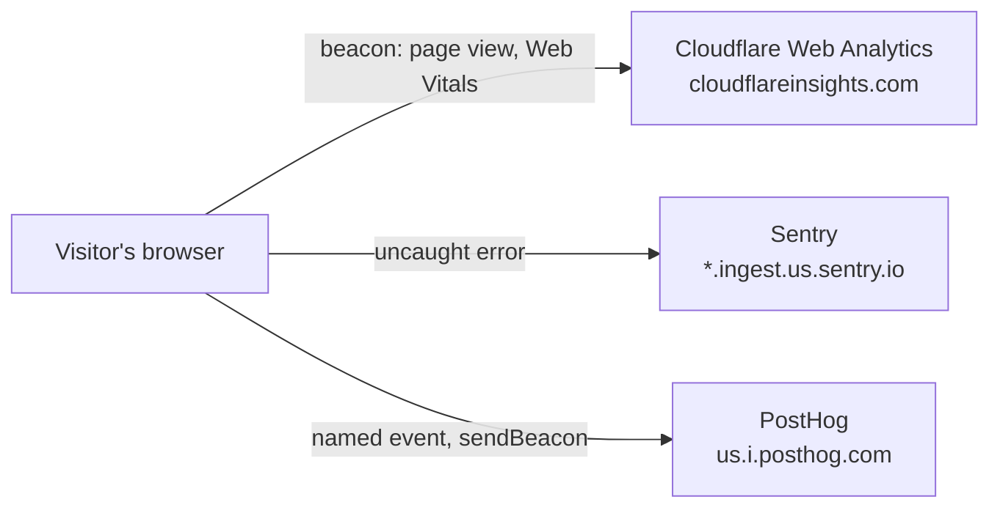

<!-- Copyright (c) 2026 Jimmy Kurian. All rights reserved. See LICENSE. Author: Jimmy Kurian. -->

# Observability

What the live site measures, with which tool, what each one never collects, and what happens at each free-tier limit.

## Overview

The site is static files on Azure Static Web Apps, so everything worth measuring happens in the visitor's browser. Three tools split the work, all cookieless and all on free plans:

| Tool | Measures | Never collects | Free tier |
| --- | --- | --- | --- |
| [Cloudflare Web Analytics](https://www.cloudflare.com/web-analytics/) | Page views, referrers, countries, Core Web Vitals | Cookies, `localStorage`, fingerprints, cross-site tracking | Free, with no DNS or proxy change (DNS stays at Namecheap) |
| [Sentry](https://sentry.io/) (Developer plan) | Uncaught JavaScript errors from the site's own scripts | Tracing, session replay, session tracking, logs, IP addresses (`sendDefaultPii: false`) | Free. Over quota, events are dropped and nothing is charged |
| [PostHog](https://posthog.com/) (US Cloud, free) | The named [events](#events) below | Pageviews, autocapture, session replay, surveys, feature flags, profiles, cookies, storage | 1M events a month. Without a card, it stops collecting at the limit |

None of the accounts has a payment method, so none of them can bill. Visitors can read what's measured at [/privacy/](https://www.jimmykurian.me/privacy/), linked in the footer.

## How it's wired

| Piece | File | Does |
| --- | --- | --- |
| Settings | GitHub repository variables `PUBLIC_CF_BEACON_TOKEN`, `PUBLIC_SENTRY_DSN`, `PUBLIC_POSTHOG_KEY`, `PUBLIC_POSTHOG_HOST` | Public client IDs, not secrets. CI passes them to the build on `main` only, plus `PUBLIC_SENTRY_RELEASE` (the commit SHA) |
| Tags | `website/src/components/Observability.astro`, in every page's `<head>` | Adds Cloudflare's beacon when its token is set, and starts the other two |
| Start-up | `website/src/lib/observability.ts` | Loads Sentry straight away and PostHog once the browser is idle, each only when its settings are set. Sentry comes through `src/lib/sentry.ts` (only `init`) and PostHog from its slim build, about 31 KB and 50 KB gzipped |
| Events | `website/src/lib/track.ts` | `track(event, props)`, and the click rule for `data-track`, `mailto:` and outbound links |
| Allowlist | `website/astro.config.mjs` (`security.csp`) | A Content-Security-Policy `<meta>` on every page: scripts only from the site and Cloudflare's beacon, connections only to the three tools |

Local builds, PR previews and the test builds get no settings, so they render no Cloudflare tag and start nothing. PostHog also drops events from automated browsers (`navigator.webdriver`), and the end-to-end tests answer the three hosts' requests themselves, so CI sends no events. Lighthouse loads the real scripts to measure their cost, which adds about a dozen Cloudflare page views per `main` run.

## Events

Every event goes through `track()` and carries only what was clicked, never anything about the visitor. PostHog counts visitors with an anonymous daily hash calculated on its servers (`$posthog_cookieless`), with no person profiles.

| Event | When | Properties |
| --- | --- | --- |
| `resume_pdf_download` | The "Download PDF" link on the home page | `target` (`/resume.pdf`) |
| `outbound_click` | Any link to another site | `host`, such as `github.com` |
| `contact_email_click` | Any `mailto:` link | none |
| `headline_pause`, `headline_play` | The home page headline's pause and play button | none |
| `reading_show_more` | "Show 10 more" on the reading list | none |

To add one, put `data-track="event_name"` on the element or call `track('event_name')`, and add a row here.

## Limits and what happens at them

| Tool | Limit | At the limit |
| --- | --- | --- |
| Cloudflare Web Analytics | None published for the free product | Keeps counting |
| Sentry | The Developer plan's monthly error quota (the account started on a 14-day Business trial, then moves to Developer) | Sentry answers `429` and the SDK drops errors until the month resets. The Developer plan can't buy more |
| PostHog | 1M events a month for product analytics. The billing limit is set to the free amount | Capture stops until the cycle resets |

## Dashboards

- **Cloudflare:** dash.cloudflare.com → Analytics → Web analytics → `www.jimmykurian.me`.
- **Sentry:** `jimmy-kurian-personal-site.sentry.io` → Issues, project `jimmykurian-me`. Sentry emails new high-priority issues.
- **PostHog:** us.posthog.com → project `jimmykurian.me` → Activity, or Product analytics for trends. **Cookieless tracking** must stay on under Settings → Web analytics, or PostHog discards every cookieless event.

## Why not OpenTelemetry

OpenTelemetry's own docs call browser instrumentation experimental and mostly unspecified, and its JavaScript logs API is still under development. A static site has no server to trace, and OpenTelemetry would also need a collector or a backend. Sentry and PostHog already cover the browser. If the site gets a server or an API, Sentry's project settings list an OTLP endpoint that could take OpenTelemetry data then.

## See also

- [Security overview](security/overview.md)
- [Testing strategy](testing/testing-strategy.md)
- [Deployment overview](deployment/overview.md)

Last reviewed: 2026-10-23
