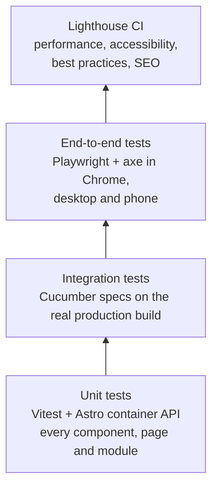

<!-- Copyright (c) 2026 Jimmy Kurian. All rights reserved. See LICENSE. Author: Jimmy Kurian. -->

# Testing strategy

What each test suite proves, where it runs and what it blocks. How to write the tests is in [CONTRIBUTING.md, Tests](../../CONTRIBUTING.md#tests), and the suites' commands and coverage are in [website/README.md, Tests](../../website/README.md#tests).

## The layers



Static checks sit underneath all of them: type-checking, ESLint, Stylelint, knip, the spelling and Markdown linters, and the rest in [CONTRIBUTING.md, Quality checks](../../CONTRIBUTING.md#quality-checks).

## Website

| Suite | Where | Tests | Needs |
| --- | --- | --- | --- |
| Unit | `website/tests/unit/` | Each component, layout, page and `src/lib/` module renders or behaves as intended, in isolation | Nothing: offline, with mocked collections |
| Integration (Cucumber) | `website/tests/integration/` | The built `dist/`: routes, links, anchors, feeds, the sitemap, the content rules, assets served locally, the deploy config, the resume PDF | A production build, with the network for Goodreads and fonts |
| End-to-end | `website/tests/e2e/` | What only a browser shows: scripts, menus, focus, layout, no console errors or horizontal scroll, and WCAG 2.0, 2.1 and 2.2 A and AA with axe | The build, served with `astro preview`, and Chrome |
| Lighthouse | `.config/lighthouserc.json` | Scores for `/`, `/writing/`, a post and `/reading/`, as the median of 3 runs | The build and Chrome |

### Unit tests

- `tests/unit/` mirrors `src/`: one test file per source file, at the same path.
- Components and pages render through Astro's container API, as they do in the build.
- `astro:content` is mocked with fixtures, and Goodreads and remote images are stubbed, so the suite runs offline.
- Snapshots cover only stable markup, normalized first.
- Coverage thresholds are 100% of statements, functions and lines, and 96% of branches. They were set at the coverage when added, so they only go up.

### Integration tests

They're behavior specs, run by Cucumber: eight Gherkin features (pages, links, assets, content rules, the hosting config and robots.txt, feeds, reading and the resume PDF) describe what the published site must do in plain sentences, and TypeScript step definitions check it. A hook builds the whole production site once, with the real content and the live Goodreads shelves, and every scenario reads the output. In CI they run against the exact `dist/` that's about to be deployed, and the check table counts passed scenarios. When a change affects what gets published (a new page, file, header or rule), it gets a scenario here.

### End-to-end tests

Playwright drives Google Chrome at 1280×800 and as a Pixel 7. A shared fixture fails any test on a console error, an uncaught exception or a failed request to the site itself, so a Content-Security-Policy violation fails too. Another answers every request to the observability hosts itself, so tests never send data to Cloudflare, Sentry or PostHog. `observability.spec.ts` runs only on a build with the observability settings (`main` in CI): it checks that the page sets no cookies and stores nothing, and that a tracked click sends one event. Locators are role-based (`getByRole`).

### Lighthouse

The build fails below 0.95 for accessibility, 0.9 for best practices and SEO, or 0.8 for performance, or above 0.1 cumulative layout shift. Performance is the loosest because CI runners are noisy. `/resume/` is left out: it's the PDF's print source and `noindex`. On `main`, Lighthouse loads the real observability scripts, so their cost is measured.

## Infrastructure

| Suite | Where | Tests |
| --- | --- | --- |
| Acceptance | `infrastructure/tests/acceptance/azure/` | One file per module: its resources, inputs, outputs and validation |
| Integration | `infrastructure/tests/integration/` | Checks across a module: secrets marked sensitive, and the site's custom domains |

The tests use `tofu test` with a mocked `azurerm` provider, so nothing plans or applies against Azure. Every module change updates its matching test. They're written as Arrange, Act, Assert, like the website's.

## Conventions

- **Arrange, Act, Assert** in every test in every suite: marked with comments in Vitest, Playwright and OpenTofu, and as `Given`, `When` and `Then` in the Cucumber features.
- **No network in unit tests.** Integration and end-to-end tests may use it, because they test the real build.
- **Snapshots are reviewed** like code. Update them only for an intended change (`pnpm vitest run -u`).

## What gates what

| Stage | Runs | Blocks |
| --- | --- | --- |
| `git push` (pre-push hook) | The unit tests if `website/` changed, the module tests if `infrastructure/` changed | The push |
| Pull request (CI) | Every suite for the parts that changed, then a preview deploy if `website/` changed | The merge (required checks) |
| `main` (CI) | Every suite again | The production deploy |
| Nightly (CI) | Every suite, then the external link check | That night's deploy |

A failing suite never deploys anything, and the last good deploy stays live. The PR check table shows each suite's result with the coverage and test counts, and the README badges show them for `main`.

## Running locally

```sh
task test               # unit tests
task build              # build dist/ and print resume.pdf
task test:integration   # integration tests on the build
task test:e2e           # end-to-end tests on the build
task lighthouse         # Lighthouse on the build
task infra:test         # OpenTofu module tests
```

## See also

- [Deployment overview](../deployment/overview.md)
- [Security overview](../security/overview.md)
- [Design guidelines](../design/design-guidelines.md)

Last reviewed: 2026-10-23
