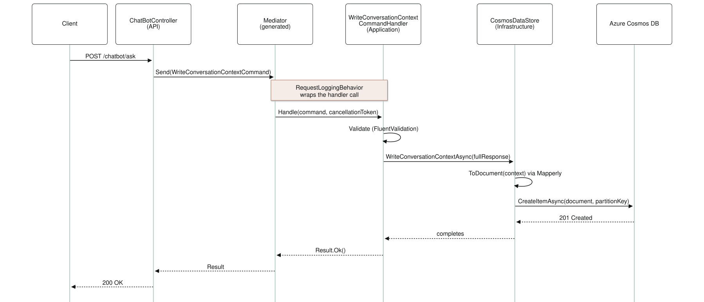

My team in Microsoft Frontier Company built a proof-of-concept AI chatbot as part of a larger effort to explore generative AI for our customers. The agent runs on Microsoft Agent Framework, the open-source .NET and Python SDK that the Semantic Kernel and AutoGen teams built as the successor to both.² The model is hosted on Microsoft Foundry, which used to be called Azure AI Foundry.¹

A proof of concept has a way of turning into the production system, so we built this one as if it already was: Clean Architecture for the layering, Domain-Driven Design for the model, CQRS for the use cases, and the Mediator pattern, through the source-generated [Mediator](https://github.com/martinothamar/Mediator) library, to connect them.³ This post goes through how each one shows up in the code and what the combination bought us.

## Why Clean Architecture?

Clean Architecture is an opinionated way to organize code so that business logic does not depend on the UI or the infrastructure. Robert C. Martin popularized it in *Clean Architecture: A Craftsman's Guide to Software Structure and Design*, and Microsoft Frontier Company has its own take on it in the form of a .NET boilerplate we use to kickstart engagements.⁴ The code is arranged in concentric layers (Presentation, Application, Domain, Infrastructure) and dependencies only point inward, so high-level policy never depends on low-level detail such as a database or a web framework.

In practice the chatbot's core logic lives in the center and the database, the model endpoint and the web API sit at the edges. The payoff is code that is easy to test and infrastructure that can be swapped without touching the core.⁵ In our solution the ASP.NET Core controllers handle HTTP and nothing else; they hand off to the Application layer, where the use-case handlers live. Those handlers depend on interfaces that the Infrastructure layer implements, for persistence and for the agent session store. That inward dependency is the Dependency Inversion principle, and it is the heart of Clean Architecture.

## Why Domain-Driven Design?

Where Clean Architecture says where code goes, Domain-Driven Design (DDD) says what the code should model. Eric Evans laid it out in *Domain-Driven Design: Tackling Complexity in the Heart of Software* and Vaughn Vernon expanded on it in *Implementing Domain-Driven Design*. Vernon's compact definition is developing a Ubiquitous Language within a Bounded Context: developers and domain experts share one vocabulary for the problem, and the software is split into contexts that follow that vocabulary.

Our bounded context is conversation management, so the code uses that vocabulary (`ConversationContext`, `ChatHistory`, `ChatTurn`) and keeps the related logic together. The domain data lives in models like `FullChatbotResponse` and `ConversationContext`, which carry what we need to persist or retrieve. Business rules and invariants belong in those models or in the use-case handlers, and nowhere else. Microsoft's microservices guidance makes the same recommendation for complex subsystems and points at Evans and Vernon as the place to start.⁶ For us, DDD thinking produced application commands and queries that line up with the business operations (ask a question, read the history, save the context), with the same names in conversation and in code.

## How the solution is laid out

The first step was laying the solution out along Clean Architecture lines. There are three layers. API is the presentation layer: controllers, dependency-injection setup, API-specific models, and the Mapperly mappers that turn domain objects into response DTOs. Application holds the use cases: the command and query handlers, the domain model, the agent definition and its tools, prompt instructions, configuration options, and the Mediator pipeline behaviors. Infrastructure holds everything external: the Cosmos DB data store and container providers, the in-memory chat-history and agent-session stores, and the mappers from domain objects to Cosmos documents.

In this PoC the layers are folders inside a single ASP.NET Core project, and the dependency rule is enforced by convention and code review. Splitting them into separate projects is a mechanical next step that lets the compiler enforce the rule; the only wiring change is telling Mediator's source generator which assemblies to scan (its `Assemblies` option). We also kept the domain model inside the Application layer instead of giving it a fourth project. The invariants were simple enough that a separate Domain project would have added ceremony without payoff, and the folder is easy to lift out later.

### Figure 1: Application folder structure

```text
chatbot-service
├── API                              # Presentation / interface adapters
│   ├── Controllers                  # ChatBotController.cs
│   ├── DependencyInjection          # Service registration extension methods
│   ├── Mapping                      # Mapperly mappers: domain -> API models
│   └── Models                       # ChatbotRequest, ChatbotResponse, ChatbotDetailedResponse
├── Application                      # Use cases and orchestration
│   ├── Agents                       # ISessionStore and the agent factory (Agent Framework)
│   ├── Commands                     # WriteConversationContextCommand and its handler
│   ├── Domain                       # ConversationContext, ChatHistory, ChatTurn, FullChatbotResponse
│   ├── Interfaces                   # ICosmosDataStore, IChatHistoryProvider
│   ├── Options                      # Configuration options (AgentSettings, CosmosSettings)
│   ├── Pipeline                     # Mediator pipeline behaviors (logging)
│   ├── Prompts                      # Agent instructions and prompt templates
│   ├── Queries                      # GetChatResponseQuery, GetUpdatedChatHistoryQuery and handlers
│   └── Tools                        # Functions the agent is allowed to call
├── Infrastructure                   # External concerns
│   ├── Mapping                      # Mapperly mappers: domain -> Cosmos documents
│   ├── Models                       # Cosmos document shapes
│   └── Persistence
│       ├── ChatHistory              # In-memory chat history provider
│       ├── Cosmos                   # CosmosDataStore, container providers
│       └── Sessions                 # In-memory agent session store
└── Program.cs                       # Composition root
```

> *Figure 1: Project structure of the chatbot service. Each layer contains only the kinds of classes relevant to its role, and Infrastructure depends on the Application layer through interfaces, never the other way around.*

This organization lets each layer evolve on its own. The API layer knows nothing about the Cosmos DB implementation in Infrastructure; it only talks to abstractions defined in Application, by way of commands and queries sent through the mediator. That inversion is what makes the system testable and lets us swap implementations without touching the use cases.

## CQRS: separating commands from queries

The use cases themselves follow CQRS (Command Query Responsibility Segregation): reads (queries) and writes (commands) have their own request types and their own handlers. Martin Fowler describes CQRS as using a different model to update information than the model you use to read it.⁷ A query never changes state and a command does not return read data, which keeps each side simple. Greg Young introduced the pattern and Fowler's writing popularized it. Fowler also cautions that for most systems CQRS adds risky complexity, and that warning is fair. Here the split earned its keep: the service has to fetch information (the agent's answer, the chat history) and record new information (the conversation context), and keeping those paths apart made the code easier to follow.

`GetChatResponseQuery` and `GetUpdatedChatHistoryQuery` are the reads; `WriteConversationContextCommand` is the write. With the Mediator library the distinction is part of the type system: queries implement `IQuery<TResponse>`, commands implement `ICommand<TResponse>`, and the handlers implement `IQueryHandler<TQuery, TResponse>` and `ICommandHandler<TCommand, TResponse>`.

```csharp
// Application/Queries/GetChatResponseQuery.cs
public sealed record GetChatResponseQuery(ChatbotRequest Request) : IQuery<Result<ChatTurn>>;

// Application/Queries/GetUpdatedChatHistoryQuery.cs
public sealed record GetUpdatedChatHistoryQuery(Guid ConversationId) : IQuery<Result<ChatHistory>>;

// Application/Commands/WriteConversationContextCommand.cs
public sealed record WriteConversationContextCommand(FullChatbotResponse FullResponse) : ICommand<Result>;
```

The controller dispatches the two queries and the command separately. It never references a handler, a repository or the agent; it only sends messages:

```csharp
// API/Controllers/ChatBotController.cs
[ApiController]
[Route("chatbot")]
public sealed class ChatBotController(
    IMediator mediator,
    IHostEnvironment environment,
    ILogger<ChatBotController> logger) : ControllerBase
{
    /// <summary>Answers a question within a conversation.</summary>
    [HttpPost("ask")]
    public async Task<IActionResult> Ask([FromBody] ChatbotRequest request, CancellationToken cancellationToken)
    {
        if (string.IsNullOrWhiteSpace(request.Question))
        {
            logger.LogWarning("Received an invalid request: {@Request}", request);
            return BadRequest(new { error = "Invalid request" });
        }

        logger.LogInformation("Received a question for conversation {ConversationId}", request.ConversationId);

        // 1. Query: run the agent and capture any tool-call context.
        var turnResult = await mediator.Send(new GetChatResponseQuery(request), cancellationToken);
        if (turnResult.IsFailed)
        {
            logger.LogError("Failed to get chat response: {Errors}", turnResult.Errors);
            return StatusCode(500, new { error = "Failed to get chat response." });
        }

        // 2. Query: read the updated chat history.
        var historyResult = await mediator.Send(new GetUpdatedChatHistoryQuery(request.ConversationId), cancellationToken);
        if (historyResult.IsFailed)
        {
            logger.LogError("Failed to retrieve chat history for conversation {ConversationId}: {Errors}",
                request.ConversationId, historyResult.Errors);
            return StatusCode(500, new { error = "Failed to retrieve chat history." });
        }

        // Compose the aggregate. This is composition, not mapping, so it stays an explicit factory method.
        var fullResponse = FullChatbotResponse.Create(request.ConversationId, turnResult.Value, historyResult.Value);

        // 3. Command: persist the conversation context.
        var writeResult = await mediator.Send(new WriteConversationContextCommand(fullResponse), cancellationToken);
        if (writeResult.IsFailed)
        {
            logger.LogError("Failed to persist conversation context for conversation {ConversationId}", request.ConversationId);
            return StatusCode(500, new { error = "Failed to persist conversation context." });
        }

        logger.LogInformation("Persisted conversation context {ContextId} for conversation {ConversationId}",
            fullResponse.Context.Id, fullResponse.ConversationId);

        // Full detail in development; only the answer everywhere else.
        return environment.IsDevelopment()
            ? Ok(ChatbotResponseMapper.ToDetailedResponse(fullResponse))
            : Ok(ChatbotResponseMapper.ToResponse(fullResponse));
    }
}
```

Each message is handled by a different part of the system. The queries gather the data for the response and the command persists the new state. Figure 2 shows the two paths side by side.

### Figure 2: CQRS flow chart

![CQRS flow chart. ChatBotController sends messages to the generated Mediator. On the left, the command side: WriteConversationContextCommandHandler validates with FluentValidation, then CosmosDataStore maps the context to a document with Mapperly and inserts it into Azure Cosmos DB, returning Result.Ok or Result.Fail. On the right, the query side: GetChatResponseQueryHandler runs the AIAgent with an AgentSession and GetUpdatedChatHistoryQueryHandler reads IChatHistoryProvider, each returning a Result with data.](./cqrs-flowchart.svg)

> *Figure 2: CQRS flow through the chatbot service. One controller and one generated mediator sit at the top, and every message passes through the same logging behavior. The command side (left) changes state: handler, validation, data store, Cosmos DB, and a Result with no data. The query side (right) only reads: each query handler reads from the agent session or the chat-history provider and returns a Result that carries data.*

Query handlers read from in-memory state (the agent session and the chat-history provider, in the current design) or from the database. The command handler always goes through the persistence layer to Azure Cosmos DB. Reads do not affect writes and vice versa, which is the whole idea.

## Routing messages with Mediator

To connect the controller to those handlers we used the Mediator pattern. A mediator encapsulates how messages reach their handlers, so the sender and the handler never reference each other. The controller gets one `IMediator`, sends a command or a query, and the mediator finds and invokes the right handler. Controllers end up very thin, and there is one central place to apply cross-cutting concerns.

### Why not MediatR

The obvious choice is Jimmy Bogard's MediatR, which is the library Microsoft's own microservices guidance uses to illustrate the pattern.⁸ In July 2025 MediatR and AutoMapper moved to a dual license: Reciprocal Public License 1.5, or a paid commercial license from Lucky Penny Software.⁹ There is a free Community edition, but only for organizations under $5 million in annual revenue, non-profits, classroom use and non-production environments. Most of our clients are above that line, so we looked elsewhere.

Martin Othamar's [Mediator](https://github.com/martinothamar/Mediator) keeps a MediatR-like API on purpose, is MIT licensed, and is built on a C# source generator with no runtime reflection.³ The generator emits the `IMediator` implementation and the `AddMediator` registration for every handler it finds, so there is no assembly scanning at startup and the output works under Native AOT. It also runs diagnostics: a query with no handler, or two handlers for the same command, is a compiler warning. And the hot path allocates less, because handlers return `ValueTask<TResponse>`, registration defaults to singleton lifetime, and the pipeline delegate passes the message and cancellation token through without capturing closures.

The library ships as two packages. `Mediator.SourceGenerator` goes in the outermost executable project (our API) and `Mediator.Abstractions` goes wherever messages and handlers are defined. Registration is one call in `Program.cs`, and pipeline behaviors are declared there:

```csharp
// Program.cs (excerpt)
builder.Services.AddMediator(options =>
{
    // Singleton is the library default and the fastest option; our handlers hold no per-request state.
    options.ServiceLifetime = ServiceLifetime.Singleton;

    // Cross-cutting behavior runs around every handler, in this order.
    options.PipelineBehaviors = [typeof(RequestLoggingBehavior<,>)];
});
```

The mediator cuts the coupling between the API layer and the business logic. `ChatBotController` knows that persisting context means sending a `WriteConversationContextCommand`; it has no idea `CosmosDataStore` exists or what validation runs. The pipeline is also where cross-cutting concerns go. Microsoft's guidance makes the same point about logging, auditing and caching,⁸ and in our case one open-generic behavior logs every message in the system:

```csharp
// Application/Pipeline/RequestLoggingBehavior.cs
public sealed class RequestLoggingBehavior<TMessage, TResponse>(
    ILogger<RequestLoggingBehavior<TMessage, TResponse>> logger)
    : IPipelineBehavior<TMessage, TResponse>
    where TMessage : IMessage
{
    public async ValueTask<TResponse> Handle(
        TMessage message,
        MessageHandlerDelegate<TMessage, TResponse> next,
        CancellationToken cancellationToken)
    {
        logger.LogInformation("Handling {MessageType}", typeof(TMessage).Name);
        var response = await next(message, cancellationToken);
        logger.LogInformation("Handled {MessageType}", typeof(TMessage).Name);
        return response;
    }
}
```

Controller constructors stay small too. The controller takes one `IMediator`, a logger and the host environment, which is the Single Responsibility Principle at work: the controller's job is HTTP and the mediator handles delegation. When Jimmy Bogard reviewed Microsoft's guide he pointed out that the request-in, response-out shape gives you a clean window for testing each use case in isolation.⁸ Our handler-level tests bore that out.

Figure 3 traces the write path end to end. A client calls `POST /chatbot/ask`, and after the two queries the controller creates a `WriteConversationContextCommand` and passes it to `IMediator.Send`. The generated mediator invokes `WriteConversationContextCommandHandler.Handle`, which validates the command and calls `ICosmosDataStore` to persist the context. The data store maps the domain object to a Cosmos document and writes it. Control returns up the chain and the API responds with HTTP 200. No component knows the inner workings of the next one.

### Figure 3: Mediator sequence diagram for the write path



> *Figure 3: Sequence diagram for a WriteConversationContextCommand. The controller hands the command to the mediator, which invokes the matching handler. The handler validates, talks to Cosmos DB through the Infrastructure layer, and returns a Result up the chain. The controller never depends on the handler, and the handler never depends on Cosmos DB beyond the interface it uses.*

Adding a feature (say, a query that returns analytics about conversations) means adding a query and a handler and exposing an endpoint. The existing flows stay untouched. Each message type is self-contained, reads and writes are not intertwined, and there is room for a separate read store or for notification handlers that react when a command completes, without disturbing the basic shape of the application.

## Mapping at the edges with Mapperly

A mediator keeps the layers from knowing about each other, but data still has to cross the boundaries, and each boundary has its own shape: API response models, domain objects, Cosmos documents. We use [Mapperly](https://github.com/riok/mapperly) for that, a source generator for object mapping under the Apache 2.0 license.¹⁰ (AutoMapper went commercial alongside MediatR in July 2025, so the same reasoning applies.⁹)

Mapperly fits for the same reason Mediator does. The mapping code is generated at build time, it has no reflection in it, and you can open the generated file and read what it does. You declare a partial mapper class and the mapping methods you want, and the generator fills them in by matching member names. A member with no counterpart shows up as a build-time diagnostic.

Mappers sit at the two edges where shapes differ. The API layer maps the domain aggregate to response DTOs:

```csharp
// API/Mapping/ChatbotResponseMapper.cs
using Riok.Mapperly.Abstractions;

[Mapper]
public static partial class ChatbotResponseMapper
{
    // Production shape: the answer only.
    public static partial ChatbotResponse ToResponse(FullChatbotResponse source);

    // Development shape: answer, chat history, and the captured tool context.
    public static partial ChatbotDetailedResponse ToDetailedResponse(FullChatbotResponse source);
}
```

The Infrastructure layer maps the domain `ConversationContext` to the document shape Cosmos DB stores, so the domain model never carries persistence attributes:

```csharp
// Infrastructure/Mapping/ConversationContextDocumentMapper.cs
using Riok.Mapperly.Abstractions;

[Mapper]
public partial class ConversationContextDocumentMapper
{
    [MapProperty(nameof(ConversationContext.CapturedAt), nameof(ConversationContextDocument.Timestamp))]
    public partial ConversationContextDocument ToDocument(ConversationContext source);
}
```

Composition is a different job and we kept it out of the mappers. Assembling a `FullChatbotResponse` from an answer, a chat history and captured tool context is domain logic with three inputs, so it lives in a factory method, `FullChatbotResponse.Create`, that a reader can follow without opening a mapper configuration.

## Running the agent on Agent Framework

The agent is defined once, in the composition root, and injected as an `AIAgent` wherever a handler needs it. Agent Framework wraps a chat client from the model provider (here Azure OpenAI on Microsoft Foundry) with instructions and the tools the agent may call. Tools are plain C# methods exposed through `AIFunctionFactory`, the role plugins played in Semantic Kernel:

```csharp
// Program.cs (excerpt)
builder.Services.AddSingleton<AIAgent>(sp =>
{
    var settings = sp.GetRequiredService<IOptions<AgentSettings>>().Value;
    var tools = sp.GetRequiredService<ConversationTools>();

    return new AzureOpenAIClient(new Uri(settings.Endpoint), new DefaultAzureCredential())
        .GetChatClient(settings.Deployment)
        .AsAIAgent(new ChatClientAgentOptions
        {
            Name = "ConversationAgent",
            Instructions = Prompts.SystemInstructions,
            ChatOptions = new ChatOptions
            {
                Tools = [AIFunctionFactory.Create(tools.LookupProductInfo)],
            },
        });
});

builder.Services.AddSingleton<ISessionStore, InMemorySessionStore>();
builder.Services.AddSingleton<IChatHistoryProvider, InMemoryChatHistoryProvider>();
builder.Services.AddSingleton<ConversationContextDocumentMapper>();
builder.Services.AddSingleton<ICosmosDataStore, CosmosDataStore>();
```

Multi-turn state lives in an `AgentSession`. Without one, each `RunAsync` call is stateless; with one, the agent carries the conversation forward. We put the session behind an `ISessionStore` abstraction in the Application layer so the handler does not care where sessions live:

```csharp
// Application/Agents/ISessionStore.cs
public interface ISessionStore
{
    ValueTask<AgentSession> GetOrCreateAsync(AIAgent agent, Guid conversationId, CancellationToken cancellationToken);

    ValueTask SaveAsync(Guid conversationId, AgentSession session, CancellationToken cancellationToken);
}
```

The query handler that answers a question is short. It resolves the session, runs the agent, saves the session, records the turn in our own chat history, and returns the answer along with any tool-call results captured from the run:

```csharp
// Application/Queries/GetChatResponseQueryHandler.cs
public sealed class GetChatResponseQueryHandler(
    AIAgent agent,
    ISessionStore sessions,
    IChatHistoryProvider history,
    ILogger<GetChatResponseQueryHandler> logger)
    : IQueryHandler<GetChatResponseQuery, Result<ChatTurn>>
{
    public async ValueTask<Result<ChatTurn>> Handle(GetChatResponseQuery query, CancellationToken cancellationToken)
    {
        var conversationId = query.Request.ConversationId;

        try
        {
            // The session carries the model-facing conversation state across turns.
            AgentSession session = await sessions.GetOrCreateAsync(agent, conversationId, cancellationToken);

            var response = await agent.RunAsync(query.Request.Question, session, cancellationToken: cancellationToken);

            await sessions.SaveAsync(conversationId, session, cancellationToken);

            var turn = new ChatTurn(response.Text, ToolContextCapture.FromResponse(response));
            history.Append(conversationId, query.Request.Question, turn.Answer);

            return Result.Ok(turn);
        }
        catch (Exception ex)
        {
            logger.LogError(ex, "Agent run failed for conversation {ConversationId}", conversationId);
            return Result.Fail<ChatTurn>(ex.Message);
        }
    }
}
```

The handler touches two framework types, `AIAgent` and `AgentSession`, and nothing from HTTP or Cosmos DB. Swapping the model, the host or the session store is an Infrastructure change.

## The write path, step by step

To make this concrete, here is the WriteConversationContext operation from start to finish. This is where, after generating a response, we persist the conversation context (the question, the answer, the updated chat history and any tool context) to the database.

1. The controller calls `mediator.Send(new WriteConversationContextCommand(fullResponse), cancellationToken)`. The `fullResponse` holds the assembled conversation data.
2. The generated mediator dispatches the command to `WriteConversationContextCommandHandler`, which implements `ICommandHandler<WriteConversationContextCommand, Result>`. The dispatch is a direct call emitted by the source generator, with no reflection lookup, and any configured pipeline behaviors (our logging behavior) run around it.
3. The handler validates the command with FluentValidation. The command type carries a nested `Validator` class with its rules, for example required fields on `FullChatbotResponse`. If validation fails, the handler logs the errors and returns a failed `Result`, which flows back through the mediator to the controller.
4. If validation passes, the handler writes to the database through the `ICosmosDataStore` interface defined in Application. The call sits in a try/catch; an exception is logged and becomes a failed `Result`, and success returns `Result.Ok()`.
5. `CosmosDataStore`, the Infrastructure implementation, maps the domain `ConversationContext` to a `ConversationContextDocument` with Mapperly and calls the Cosmos DB SDK's `CreateItemAsync` with the conversation ID as the partition key. Success is logged; failure throws so the handler can turn it into a `Result`.
6. Control returns to the handler, which returns `Result.Ok()`, which the mediator returns to the controller.
7. The controller checks the result. On success it logs the persisted context ID and returns the HTTP response, the full detail in development and only the answer otherwise. On failure it returns a 500.

Here is the handler (steps 3 and 4) and the Cosmos DB write (step 5):

```csharp
// Application/Commands/WriteConversationContextCommandHandler.cs
public sealed class WriteConversationContextCommandHandler(
    ICosmosDataStore cosmosDataStore,
    ILogger<WriteConversationContextCommandHandler> logger)
    : ICommandHandler<WriteConversationContextCommand, Result>
{
    public async ValueTask<Result> Handle(WriteConversationContextCommand command, CancellationToken cancellationToken)
    {
        // Validate the command with FluentValidation.
        var validation = new WriteConversationContextCommand.Validator().Validate(command);
        if (!validation.IsValid)
        {
            var errors = string.Join("; ", validation.Errors.Select(e => e.ErrorMessage));
            logger.LogWarning("Validation failed: {Errors}", errors);
            return Result.Fail($"Validation failed: {errors}");
        }

        try
        {
            // Delegate persistence to Infrastructure through the interface.
            await cosmosDataStore.WriteConversationContextAsync(command.FullResponse, cancellationToken);
            return Result.Ok();
        }
        catch (Exception ex)
        {
            logger.LogError(ex, "Error writing conversation context");
            return Result.Fail(ex.Message);
        }
    }
}
```

The handler makes no business decisions beyond validation; it orchestrates. If saving a conversation had complex invariants they would live in the domain model and the handler would call into it. That is the DDD split: the handler is Application-layer code and defers to the domain for anything heavy.⁸ It also depends on an interface and never on a Cosmos client, which is dependency inversion in practice; the implementation arrives through DI. Returning a `Result` (from the [FluentResults](https://github.com/altmann/FluentResults) library) in place of an exception lets the controller treat success and failure the same way.

```csharp
// Infrastructure/Persistence/Cosmos/CosmosDataStore.cs
public sealed class CosmosDataStore(
    IResponseContainerProvider containerProvider,
    ConversationContextDocumentMapper mapper,
    CosmosMetrics metrics,
    ILogger<CosmosDataStore> logger) : ICosmosDataStore
{
    private static readonly ActivitySource ActivitySource = new("ChatbotService.Cosmos");

    public async Task WriteConversationContextAsync(FullChatbotResponse fullResponse, CancellationToken cancellationToken)
    {
        using var activity = ActivitySource.StartActivity("CosmosDataStore.WriteConversationContext");
        var stopwatch = Stopwatch.StartNew();

        try
        {
            Container container = await containerProvider.GetContainerAsync(cancellationToken);

            // Domain object in, persistence document out (generated at build time by Mapperly).
            var document = mapper.ToDocument(fullResponse.Context);

            await container.CreateItemAsync(
                document,
                new PartitionKey(fullResponse.ConversationId.ToString()),
                cancellationToken: cancellationToken);

            logger.LogInformation("Conversation context written for conversation {ConversationId}", fullResponse.ConversationId);
            activity?.SetTag("cosmos.write_conversation_context.success", true);
        }
        catch (Exception ex)
        {
            logger.LogError(ex, "Error writing conversation context to Cosmos DB.");
            activity?.SetTag("cosmos.write_conversation_context.success", false);
            throw; // The handler turns this into a failed Result.
        }
        finally
        {
            stopwatch.Stop();
            metrics.WriteResponseDuration.Record(stopwatch.Elapsed.TotalMilliseconds);
        }
    }
}
```

This is the Infrastructure layer. The store maps the context to a document and inserts it with the Cosmos DB SDK. The write is insert-only: every call creates a new item, and the conversation ID is the partition key so all contexts for a conversation live together. Logging and metrics are ancillary but we wanted them from day one. If the write fails (a connectivity issue, say), we log, tag the activity, and rethrow for the handler, which translates it into an HTTP 500 at the controller.

One choice matters later: we never update an existing record. Combined with CQRS, that means we append to the conversation log and leave earlier entries alone, which has consequences for concurrency and for future queries. More on that next.

## Decisions along the way

### Where a conversation lives

A conversation currently lives in three places. Agent Framework keeps the model-facing conversation in an `AgentSession`, which the PoC holds in memory behind `ISessionStore`. Our own `IChatHistoryProvider`, also in memory, keeps the domain-level record of questions and answers that the API returns. And the `ConversationContext` written to Cosmos DB after every turn is the durable snapshot: full history plus the tool context needed to pick the conversation back up later. That is one more copy than a production system should carry.

The consolidation path is already open. Agent Framework can serialize a session to JSON and restore it (`agent.SerializeSessionAsync(session)` and `agent.DeserializeSessionAsync(state)`), so a Cosmos-backed `ISessionStore` can persist session state next to the context document, and the chat-history query can read from the same store. Microsoft Foundry's agent service can also hold the conversation server-side. Either way the swap is an Infrastructure change plus a new query handler. The controller and the other handlers do not move, because they depend on abstractions and on CQRS messages.

### Race conditions

Could the design read stale data or overwrite concurrent updates? A few choices keep that risk low. Each command is handled synchronously to completion: when the controller awaits `Send`, it does not continue until the handler and the database write finish, and nothing is fire-and-forget, so by the time we respond to the client the write has succeeded or failed. Writes are insert-only, so there is no upsert to conflict with another update; every question produces a new context entry with a unique ID, and two writes for the same conversation arriving close together produce two records, not a lost update.

Cosmos DB's consistency model covers the rest. Strong consistency offers a linearizability guarantee, and the account default, Session consistency, guarantees read-your-writes within a session.¹¹ If a handler ever needs to read a context immediately after writing it (not in the current flow), it will see the latest committed version. The read side currently pulls chat history from in-process state that is updated sequentially per request, and the write side appends to the database, so a stale database read cannot corrupt the user-facing response. When sessions move to Cosmos DB, each message will keep a unique ID and will only ever be added, never updated, so the same reasoning holds. Optimistic concurrency with ETags is there if a true update ever becomes necessary.

### Observability

Routing everything through the mediator made observability cheap. One pipeline behavior logs every message. Each layer logs its own part: the controller at request level, handlers on validation and errors, the data store on database operations. `ActivitySource` and metrics in `CosmosDataStore` record database performance. Mediator can also emit OpenTelemetry-conformant metrics and traces for every message it dispatches, configured on the same options object, which gave us a per-message histogram for free.³

### Adding features later

New features (multiple chat sessions, extra metadata per turn, a new tool for the agent) slot in without touching unrelated code. A new query is a new type and a new handler. A new business rule, say a cap on conversation length, goes in a domain service or the relevant handler and has no effect on the read models. A new tool is a C# method added to the agent's tool list. DDD and CQRS together push you to think in use cases and aggregates, which maps well to how features arrive.

## What it bought us

The PoC showed that this architecture can carry an AI-driven application into production. API, Application and Infrastructure evolve on their own cadence, so engineers working on conversational logic could proceed independently of those working on the Foundry integration or on persistence. CQRS and the mediator gave us one pipeline for every interaction, and because Mediator and Mapperly are source generators, the wiring between layers is checked by the compiler before the app ever starts.

It also gave us confidence that the design will hold as the chatbot grows. Changing the model, the hosting platform or how conversation state is stored is an Infrastructure change behind an interface. A team moving from Semantic Kernel to Agent Framework, for example, would touch the handler that runs the agent and nothing else. Handler-level tests (send a message, assert on the result) gave us fast, isolated coverage of each use case, and clear boundaries meant people could work on different parts without stepping on each other. The habit that carries to any AI-assisted system is treating the model call as one more piece of infrastructure behind an interface, with the domain and the read and write paths kept out of its way.

## References

1. Microsoft. *Microsoft Foundry documentation*. [learn.microsoft.com/azure/ai-foundry](https://learn.microsoft.com/en-us/azure/ai-foundry/)
2. Microsoft. *Microsoft Agent Framework overview*. [learn.microsoft.com/agent-framework/overview](https://learn.microsoft.com/agent-framework/overview/) and the [microsoft/agent-framework](https://github.com/microsoft/agent-framework) repository.
3. Othamar, M. *Mediator: a high performance implementation of the Mediator pattern in .NET using source generators*. [github.com/martinothamar/Mediator](https://github.com/martinothamar/Mediator)
4. Lugasi-Gal, D. "Next-Level Boilerplate: An Inside Look Into Our .Net Clean Architecture Repo." *ISE Developer Blog*, June 2024. [devblogs.microsoft.com/ise/next-level-clean-architecture-boilerplate](https://devblogs.microsoft.com/ise/next-level-clean-architecture-boilerplate/)
5. Microsoft. "Common web application architectures." *Architect Modern Web Applications with ASP.NET Core and Azure*. [learn.microsoft.com](https://learn.microsoft.com/en-us/dotnet/architecture/modern-web-apps-azure/common-web-application-architectures)
6. Microsoft. "Tackle business complexity in a microservice with DDD and CQRS patterns." *.NET Microservices: Architecture for Containerized .NET Applications*. [learn.microsoft.com](https://learn.microsoft.com/en-us/dotnet/architecture/microservices/microservice-ddd-cqrs-patterns/)
7. Fowler, M. "CQRS." *martinfowler.com*, 2011. [martinfowler.com/bliki/CQRS.html](https://martinfowler.com/bliki/CQRS.html). See also the Azure Architecture Center's [CQRS pattern](https://learn.microsoft.com/en-us/azure/architecture/patterns/cqrs).
8. Microsoft. "Implement the microservice application layer using the Web API." *.NET Microservices: Architecture for Containerized .NET Applications*. [learn.microsoft.com](https://learn.microsoft.com/en-us/dotnet/architecture/microservices/microservice-ddd-cqrs-patterns/microservice-application-layer-implementation-web-api)
9. Bogard, J. "AutoMapper and MediatR Commercial Editions Launch Today." July 2, 2025. [jimmybogard.com](https://www.jimmybogard.com/automapper-and-mediatr-commercial-editions-launch-today/)
10. riok. *Mapperly: a .NET source generator for generating object mappings*. [github.com/riok/mapperly](https://github.com/riok/mapperly)
11. Microsoft. "Consistency levels in Azure Cosmos DB." [learn.microsoft.com/azure/cosmos-db/consistency-levels](https://learn.microsoft.com/azure/cosmos-db/consistency-levels)

Books referenced: Robert C. Martin, *Clean Architecture: A Craftsman's Guide to Software Structure and Design* (2017); Eric Evans, *Domain-Driven Design: Tackling Complexity in the Heart of Software* (2003); Vaughn Vernon, *Implementing Domain-Driven Design* (2013).
